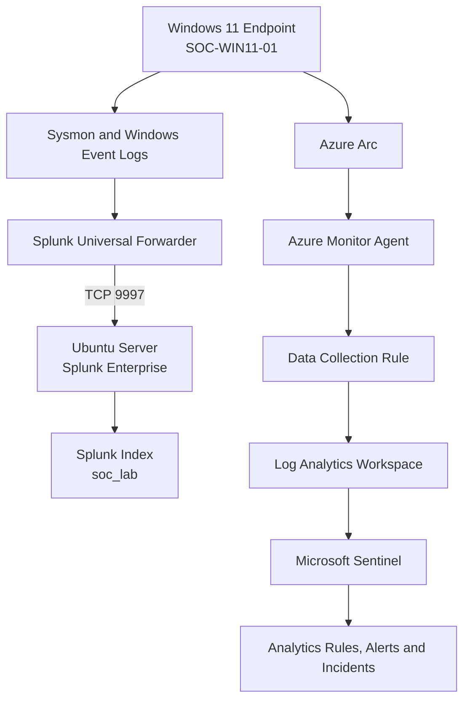

# SOC Home Lab Architecture

## 1. Overview

The lab uses a Windows 11 endpoint to generate security telemetry. The endpoint sends logs to two monitoring platforms through separate collection paths:

- **Splunk Enterprise:** Windows telemetry is collected by the Splunk Universal Forwarder and forwarded to the Splunk server.
- **Microsoft Sentinel:** The Windows endpoint is onboarded through Azure Arc, with Azure Monitor Agent and a Data Collection Rule (DCR) configured for Windows Security Events.

The environment is hosted in VMware Workstation.

## 2. Architecture Diagram

## 3. Lab Components

| Component | Role |
|---|---|
| VMware Workstation | Runs the virtual machines |
| Windows 11 | Endpoint generating security telemetry |
| Sysmon | Provides detailed system and process events |
| Splunk Universal Forwarder | Sends Windows logs to Splunk |
| Ubuntu Server | Hosts Splunk Enterprise |
| Splunk `soc_lab` index | Stores collected lab events |
| Azure Arc | Connects the Windows endpoint to Azure management |
| Azure Monitor Agent | Collects configured Windows telemetry for Azure Monitor |
| Data Collection Rule | Defines the configured event collection |
| Log Analytics Workspace | Stores Sentinel-connected log data |
| Microsoft Sentinel | Supports analytics, alerting and incident investigation |

## 4. Network Configuration

The dedicated SOC lab subnet is `192.168.50.0/24`.

| Device | Interface / Address | Purpose |
|---|---|---|
| Splunk server | `192.168.50.10/24` | SIEM and log receiver |
| Windows endpoint | `192.168.50.20/24` | Monitored endpoint |
| Splunk Web | `http://192.168.50.10:8000` | Splunk management and search interface |
| Splunk receiving port | TCP `9997` | Forwarder-to-Splunk communication |

The Windows endpoint also uses a separate NAT interface for internet connectivity. The dedicated SOC interface is configured without a default gateway.

## 5. Telemetry Collection Paths

### Splunk

1. Windows Security, System, Application, Sysmon and PowerShell logs are configured for collection.
2. The Universal Forwarder sends configured events to the Splunk server.
3. Events are stored in the `soc_lab` index.
4. SPL searches support monitoring, detection and threat hunting.

### Microsoft Sentinel

1. The Windows endpoint is connected through Azure Arc.
2. Azure Monitor Agent collects events according to the configured DCR.
3. Windows Security Events are ingested into the Log Analytics workspace.
4. Sentinel analytics rules evaluate configured patterns.
5. Alerts and incidents support investigation and triage.

## 6. Detection and Investigation Coverage

The lab includes detection scenarios for:

- Multiple failed logons and possible brute-force activity
- Suspicious encoded PowerShell execution
- CertUtil encode/decode activity
- Registry Run Key persistence
- Windows discovery activity bursts
- DNS failures and anomalous patterns

Threat-hunting exercises cover PowerShell, CertUtil, registry persistence, failed-to-successful authentication patterns, and DNS anomalies.

These patterns require investigation and context; an individual matching event does not automatically establish malicious activity.

## 7. Validation

Validation included checking the Splunk service and receiving port, verifying Windows event sources in Splunk, testing selected detections with controlled activity, and checking Sentinel event ingestion and incident results.

## 8. Security Considerations

- Testing is restricted to the controlled lab.
- Secrets and credentials must not be included in repository files.
- Screenshots should be reviewed for personal information and subscription identifiers before publication.
- VM disk files and other large runtime artifacts should remain outside the Git repository.
